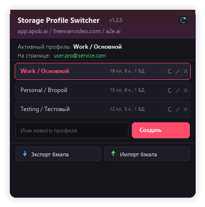

# 🔄 Browser Storage Profile Switcher

**Multi-account session & storage profile manager for modern browsers (Opera GX, Chrome, Edge, Brave)**  
*Многопрофильный менеджер сессий для современных браузеров*

 

 

  <a href="README.md"><b>🇷🇺 Читать на русском (Russian Version)</b></a> &nbsp;•&nbsp; 
  <b>🇬🇧 English Version</b>

---

### 💡 About The Project

Most profile/account switchers only handle `cookies`. However, modern web apps and Single Page Applications (Next.js, React, Firebase Auth) store credentials much deeper: inside **`localStorage`**, **`sessionStorage`**, and **`IndexedDB`**.

**Browser Storage Profile Switcher** is a Manifest V3 browser extension that creates a complete snapshot of the entire client-side origin state in one click:
* 🍪 **Cookies** (properly handling domains, paths, and secure flags)
* 💾 **LocalStorage & SessionStorage** (including complex JSON structures)
* 🗄️ **IndexedDB** (including `firebaseLocalStorageDb` and SPA offline stores)
* 💾 **Backup & Restore (Export / Import):** one-click `.json` export and smart merge import that never overwrites fresh sessions.
* ⚡ **Race Condition Immunity:** freezes active background polling (GraphQL, WebSockets) and unmount hooks during switching to eliminate unexpected logouts.
* 🛡️ **Cross-Account Clobber Guard:** prevents accidentally overwriting an active profile with an unauthorized or mismatched session.

---

### 📥 1-Minute Installation (No builds, no dev setups!)

> **No Node.js, CLI, or source building required.** Download the ready-to-use production release directly:

1. **[👉 Download BrowserStorageProfileSwitcher.zip (Latest Release)](https://github.com/Mmitekk/BrowserStorageProfileSwitcher/releases/latest)**
2. Extract the downloaded zip file into any permanent folder on your computer.
3. Open your browser's extensions page:
   * **Opera / Opera GX:** enter `opera://extensions` in the address bar
   * **Google Chrome:** `chrome://extensions`
   * **Microsoft Edge:** `edge://extensions`
   * **Brave:** `brave://extensions`
4. Toggle on **"Developer mode"** in the top-right corner.
5. Click **"Load unpacked"** in the top-left corner.
6. Select the extracted extension directory.
7. Pin the extension icon to your toolbar — you are all set!

---

### 🚀 Usage Guide

1. Open any web service where you have multiple accounts.
2. Sign in to your first account.
3. Click the extension icon in your browser toolbar:
   * Enter a label (e.g. `Work` or your `email`) and click **"Create"**.
   * The live session (cookies + storage + IndexedDB) is captured into this profile.
4. Sign out and log in with your second account.
5. Open the extension, enter a label (e.g. `Personal`), and click **"Create"**.
6. **Switching:** Click any profile in the list. The extension saves the live session, swaps all storage layers, and reloads the page into the selected account.
7. **Syncing (↻):** Click the circular arrow icon next to a profile anytime you want to re-save current cookies and storage after updating account settings.

---

### ⚙️ Key Technical Features

* **Complete Origin Snapshot:** Handles cookies, local/session storage, and IndexedDB snapshots.
* **Worker Auto-Reload (↺):** Automatically syncs background service worker code upon updates without requiring a full browser restart.
* **Live Status Badge:** Displays the actual active identity directly in the popup header.

---

### 📄 License

Distributed under the [MIT License](LICENSE). Free for personal and commercial use.

