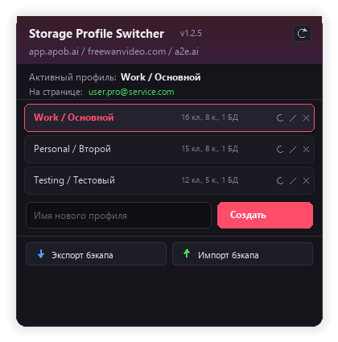

# 🔄 Browser Storage Profile Switcher

**Многопрофильный менеджер сессий для современных браузеров (Opera GX, Chrome, Edge, Brave)**  
*Multi-account session & storage profile manager for modern browsers*

 

 

<!-- Language Switch Navigation -->

  <a href="#-русский"><b>🇷🇺 Перейти к Русской версии</b></a> &nbsp;•&nbsp; 
  <a href="#-english"><b>🇬🇧 Switch to English version</b></a>

---

<h2 style="display:inline;">🇷🇺 Русский (нажмите для сворачивания / разворачивания)</h2>

### 💡 О проекте

Большинство расширений для смены аккаунтов умеют переключать только `cookies`. Но современные веб-сервисы и SPA-приложения (например, на Next.js, React, Firebase Auth) хранят токены авторизации и сессии глубже: в **`localStorage`**, **`sessionStorage`** и базе **`IndexedDB`**.

**Browser Storage Profile Switcher** — это расширение Manifest V3, которое делает полный снимок всей клиентской сессии домена в один клик:
* 🍪 **Cookies** (с правильным сопоставлением доменов и защищённых флагов)
* 💾 **LocalStorage** и **SessionStorage** (включая сложные JSON-объекты)
* 🗄️ **IndexedDB** (включая базы `firebaseLocalStorageDb` и другие локальные хранилища)
* 💾 **Резервное копирование (Экспорт / Импорт):** скачивание всех ваших профилей в один файл `.json` и безопасное восстановление с умным объединением (Merge).
* ⚡ **Защита от Race Condition:** мгновенная заморозка фонового поллинга (GraphQL, WebSockets) и хуков размонтирования при переключении исключает сброс сессий и случайный разлогин.
* 🛡️ **Защита от затирания сессий (Cross-Account Guard):** невозможно случайно перезаписать активный профиль пустой страницей или сессией другого аккаунта.

---

### 📥 Установка за 1 минуту (Без компиляции и dev-версий!)

> **Вам не нужны Node.js, терминал, npm или сборка из исходников.** Устанавливается сразу готовый production-билд расширения:

1. **[👉 Скачать BrowserStorageProfileSwitcher.zip (Последний релиз)](https://github.com/Mmitekk/BrowserStorageProfileSwitcher/releases/latest)**
2. Распакуйте скачанный zip-архив в любую постоянную папку на компьютере (например, `C:\Extensions\BrowserStorageProfileSwitcher` или любую удобную).
3. Откройте в браузере страницу расширений:
   * **Opera / Opera GX:** введите в адресной строке `opera://extensions`
   * **Google Chrome:** `chrome://extensions`
   * **Microsoft Edge:** `edge://extensions`
   * **Яндекс Браузер:** `browser://tune` или `chrome://extensions`
   * **Brave:** `brave://extensions`
4. В правом верхнем углу включите тумблер **«Режим разработчика»** (*Developer mode*).
5. Нажмите кнопку **«Загрузить распакованное»** (*Load unpacked*) в левом верхнем углу.
6. Выберите папку, в которую вы распаковали архив.
7. Закрепите иконку расширения на панели инструментов браузера — готово к использованию!

---

### 🚀 Как пользоваться

1. Откройте нужный сайт (например, `app.apob.ai`, `freewanvideo.com`, `a2e.ai` или любой другой сервис).
2. Войдите в свой первый аккаунт.
3. Нажмите на иконку расширения в панели браузера:
   * Введите имя (например, `Основной` или ваш `email`) и нажмите кнопку **«Создать»**.
   * Текущая сессия (cookies + storage + IndexedDB) мгновенно зафиксируется в этот профиль.
4. Разлогиньтесь на сайте и войдите во второй аккаунт.
5. Снова откройте расширение, введите имя (например, `Второй`) и нажмите **«Создать»**.
6. **Переключение:** просто нажмите на название нужного профиля в списке. Расширение автоматически сохранит текущее состояние активного профиля, мгновенно подменит хранилища и перезагрузит страницу в нужном аккаунте.
7. **Обновление сессии (↻):** если вы продлили подписку или обновили данные, нажмите круглую стрелку ↻ рядом с именем профиля, чтобы зафиксировать актуальное состояние.

---

### ⚙️ Возможности и надёжность

* **Строгая изоляция:** ключи одного аккаунта не смешиваются с ключами другого.
* **Автоперезагрузка воркера (↺):** при обновлении файлов расширения Service Worker автоматически подтягивает свежий код без необходимости перезапускать весь браузер.
* **Индикатор сессии:** прямо в шапке попапа видно, под каким именно аккаунтом открыта страница прямо сейчас.

---

<h2 style="display:inline;">🇬🇧 English (click to expand / collapse)</h2>

### 💡 About The Project

Most profile/account switchers only handle `cookies`. However, modern web apps and Single Page Applications (Next.js, React, Firebase Auth) store credentials much deeper: inside **`localStorage`**, **`sessionStorage`**, and **`IndexedDB`**.

**Browser Storage Profile Switcher** is a Manifest V3 browser extension that creates a complete snapshot of the entire client-side origin state in one click:
* 🍪 **Cookies** (properly handling domains, paths, and secure flags)
* 💾 **LocalStorage & SessionStorage** (including complex JSON structures)
* 🗄️ **IndexedDB** (including `firebaseLocalStorageDb` and SPA offline stores)
* 💾 **Backup & Restore (Export / Import):** one-click `.json` export and smart merge import that never overwrites fresh sessions.
* ⚡ **Race Condition Immunity:** freezes active background polling (GraphQL, WebSockets) and unmount hooks during switching to eliminate unexpected logouts.
* 🛡️ **Cross-Account Clobber Guard:** prevents accidentally overwriting an active profile with an unauthorized or mismatched session.

---

### 📥 1-Minute Installation (No builds, no dev setups!)

> **No Node.js, CLI, or source building required.** Download the ready-to-use production release directly:

1. **[👉 Download BrowserStorageProfileSwitcher.zip (Latest Release)](https://github.com/Mmitekk/BrowserStorageProfileSwitcher/releases/latest)**
2. Extract the downloaded zip file into any permanent folder on your computer.
3. Open your browser's extensions page:
   * **Opera / Opera GX:** enter `opera://extensions` in the address bar
   * **Google Chrome:** `chrome://extensions`
   * **Microsoft Edge:** `edge://extensions`
   * **Brave:** `brave://extensions`
4. Toggle on **"Developer mode"** in the top-right corner.
5. Click **"Load unpacked"** in the top-left corner.
6. Select the extracted extension directory.
7. Pin the extension icon to your toolbar — you are all set!

---

### 🚀 Usage Guide

1. Open any web service where you have multiple accounts.
2. Sign in to your first account.
3. Click the extension icon in your browser toolbar:
   * Enter a label (e.g. `Work` or your `email`) and click **"Create"**.
   * The live session (cookies + storage + IndexedDB) is captured into this profile.
4. Sign out and log in with your second account.
5. Open the extension, enter a label (e.g. `Personal`), and click **"Create"**.
6. **Switching:** Click any profile in the list. The extension saves the live session, swaps all storage layers, and reloads the page into the selected account.
7. **Syncing (↻):** Click the circular arrow icon next to a profile anytime you want to re-save current cookies and storage after updating account settings.

---

### ⚙️ Key Technical Features

* **Complete Origin Snapshot:** Handles cookies, local/session storage, and IndexedDB snapshots.
* **Worker Auto-Reload (↺):** Automatically syncs background service worker code upon updates without requiring a full browser restart.
* **Live Status Badge:** Displays the actual active identity directly in the popup header.

---

### 📄 License

Distributed under the [MIT License](LICENSE). Free for personal and commercial use.

